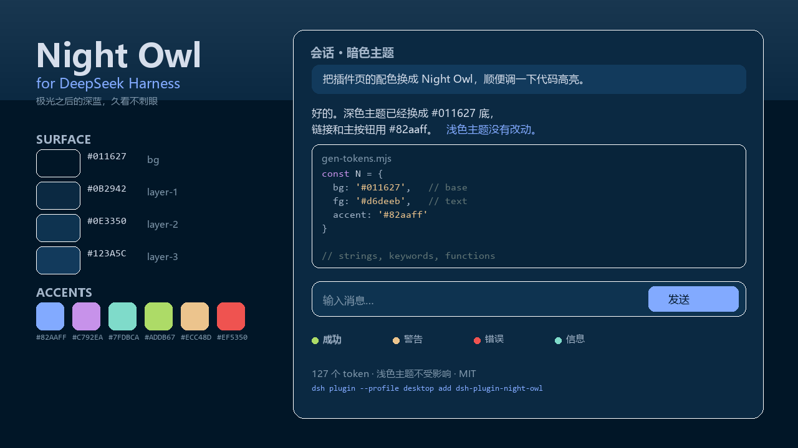

# Night Owl for DeepSeek Harness



把 [Night Owl](https://github.com/sdras/night-owl-vscode-theme)（Sarah Drasner 的深蓝配色）带进 DSH Web 客户端：`#011627` 的底色、`#d6deeb` 的正文、`#82aaff` 的强调色，外加一整套 Night Owl 的语法高亮。

它不新增主题入口，而是往当前主题上叠一层 **token 覆盖**：浅色主题原封不动，深色主题整个换成 Night Owl。设置 → 通用里的「深色 / 浅色 / 跟随系统」照常工作。

## 安装

```powershell
dsh plugin --profile desktop add dsh-plugin-night-owl
```

Web profile 把 `desktop` 换成 `web`。装完 **重启客户端** 生效。

卸载：

```powershell
dsh plugin --profile desktop remove dsh-plugin-night-owl
```

或插件页 → 已安装插件 → 本插件 → 卸载。

## 它改了哪些东西

| 类别 | token | 说明 |
| --- | --- | --- |
| 底色 | `--dsw-alias-bg-base` 等 16 个 | `#011627` 到 `#123a5c` 的深蓝阶梯 |
| 文字 | `--dsw-alias-label-*` 9 个 | `#d6deeb` / `#a3b5c9` / `#7f97ab` |
| 边框 | `--dsw-alias-border-*` 7 个 | 半透明白，按层级递增 |
| 强调 | `--dsw-alias-brand-*`、`link`、`state-business-*` | `#82aaff`，副强调 `#7fdbca`、`#c792ea` |
| 状态 | success / warn / error | `#addb67` / `#ecc48d` / `#ef5350` |
| 侧栏 | `--dsw-specific-sidebar-*` 等 11 个 | 底色压到 `#01111d`，选中行用蓝色阶梯 |
| 代码块 | `--shiki-token-*` 11 个 | 关键字紫、函数蓝、字符串黄、注释青灰 |

共 127 个 token，浅色值沿用 DSH 原本的定义，因此只有深色模式会变。

## 调色

改 `tools/gen-tokens.mjs` 里的 `N` 调色板和映射表，然后：

```powershell
node tools/gen-tokens.mjs
```

`tools/token-source.json` 是 DSH 原主题的浅/深 token 快照；DSH 升级后若要重新对齐，可以重新导出。

## 已知取舍

- Night Owl 的注释色 `#637777` 在 `#011627` 上只有 3.9:1，所以它只用在代码高亮里；界面上的 caption 小字换成了 `#7d9494`（5.2:1）。
- 终端 ANSI 16 色由终端插件自己管，不在主题 token 里，需要单独改。
- 如果同时装了壁纸插件，壁纸会盖住 `#011627` 底色；想看到完整效果需要关掉壁纸，或把壁纸透明度调得很低。

## 兼容与权限

- DSH 0.2.x，Web 与 Desktop 客户端均可；只依赖 `@deepseek-ai/dsh-client-ui-theme` 提供的 `ctx.theme`。
- 不发网络请求、不注册工具、不读写任何文件，只在浏览器里改 CSS 变量。
- 卸载后立刻恢复原主题，不会留下配置。

## English

Night Owl palette for the DeepSeek Harness Web client. Dark theme only — the light palette keeps DSH's original tokens, so light/dark/system switching still works.

```powershell
dsh plugin --profile desktop add dsh-plugin-night-owl
```

Restart the client after installing. 127 theme tokens are overridden through `ctx.theme.overrideTokens()`; nothing is written to disk, no network access, no tools registered. MIT licensed.

## 致谢

调色板来自 Sarah Drasner 的 [Night Owl](https://github.com/sdras/night-owl-vscode-theme)（MIT）。本包只把这些颜色映射到 DSH 的 token 上，不包含原主题的代码。
